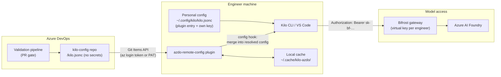

# Product Vision

> **This is the only file a human needs to write.**
> The Product Owner transforms this vision into a backlog, and the factory delivers it incrementally.

# Kilo Shared Config — Product Vision
 
**Status:** Draft · **Owner:** Mohamed · **Date:** 2026-10-30
 
---
 
## 1. Vision
 
Every engineer's Kilo — CLI and VS Code extension — runs on the same company-approved models, agents and settings, managed in **one reviewed file in Azure DevOps**, while each engineer authenticates to the model gateway **as themselves**.
 
A config change merged to `main` reaches all ~100 engineers on their next Kilo start, with no manual copying and no secrets in the repo.
 
## 2. Problem
 
- We use **Kilo Code** (VS Code) and **Kilo CLI** as our coding-agent harness, with our own models served through a **Bifrost gateway** in front of **Azure AI Foundry**.
- The configuration (`kilo.jsonc`: providers, models, agents, settings) must be identical for ~100 engineers.
- Kilo has **no built-in way to load configuration from a remote source**.
- Today the file is copied by hand, which causes:
  - **Drift:** engineers run different models and settings.
  - **Slow rollout:** a new model or setting takes days to reach everyone.
  - **Secret risk:** a shared file invites shared or committed API keys.
## 3. Users and goals
 
| User | Goal | What they need from this product |
|---|---|---|
| Platform team | Change config once, reach everyone | One file in Azure DevOps, PR-reviewed, live on next start |
| Engineer | Kilo just works, CLI and VS Code | One-time setup, no manual syncing, works offline |
| Security | No leaked or shared credentials | No secrets in the repo, one revocable key per person, usage attributed per person |
 
## 4. Scope
 
### In scope
 
1. **Remote config plugin** for Kilo that loads the shared `kilo.jsonc` from Azure DevOps at startup.
2. **Shared config repo** in Azure DevOps with validation pipeline and branch policy.
3. **Personal config template**, one per engineer, holding only the plugin entry and their own key.
4. **Bootstrap installer** (Windows, macOS, Linux) that sets up a machine in one command.
5. **Key provisioning script** that creates, lists and disables one Bifrost virtual key per engineer.
### Out of scope / non-goals
 
- Forking or modifying Kilo itself.
- Operating Bifrost or Azure Foundry (they exist; we only consume them).
- Storing any secret in the shared repo.
- Project-level (`.kilo/`) configuration management.
- Bifrost Enterprise SSO self-service keys (possible future phase).
## 5. Architecture
 

 
### Components
 
| ID | Component | Location | Responsibility |
|---|---|---|---|
| C1 | Shared config repo | Azure DevOps repo `kilo-config`, file `/kilo.jsonc` | Single source of truth for providers, models, agents, settings |
| C2 | Remote config plugin | `~/.config/kilo/azdo/azdo-remote-config.ts` | Fetch, parse, resolve and merge C1 into Kilo's config at startup |
| C3 | Personal config | `~/.config/kilo/kilo.jsonc` | Plugin entry with its settings, plus the engineer's own virtual key |
| C4 | Bifrost gateway | Existing | Authenticates virtual keys, enforces budgets and limits, routes to Foundry |
| C5 | Bootstrap installer | `install.ps1`, `install.sh` in C1's repo | One-command machine setup |
| C6 | Key provisioning script | Platform team tooling | Create, list and disable per-engineer virtual keys via Bifrost's governance API |
 
### Startup sequence
 
1. Kilo reads the personal config (C3) and loads the plugin listed in its `plugin` array.
2. The plugin reads its settings from its plugin options.
3. The plugin fetches `/kilo.jsonc` from the configured branch of C1.
4. It parses the JSONC and resolves `{env:…}` and `{file:…}` placeholders.
5. It writes the result to the local cache, or falls back to the cache if the fetch fails.
6. Kilo calls the plugin's `config` hook, and the plugin merges the shared config into the resolved config in place.
7. Kilo starts. Model calls go to Bifrost with the engineer's own virtual key.
## 6. Functional requirements
 
### Plugin (C2)
 
| ID | Requirement |
|---|---|
| FR-1 | Read settings (`org`, `project`, `repo`, `path`, `branch`, `mode`, `pat`, `timeoutMs`) from the plugin's options in `kilo.jsonc`; fall back to `KILO_AZDO_*` env vars, then built-in defaults. |
| FR-2 | Fetch the file with the Azure DevOps Git Items API (`api-version=7.1`), scoped to the configured branch, with `includeContent=true`. |
| FR-3 | Authenticate with the `pat` option or `AZDO_PAT` / `AZURE_DEVOPS_EXT_PAT` (Basic auth); otherwise use an Entra token from `az account get-access-token --resource 499b84ac-1321-427f-aa17-267ca6975798`. |
| FR-4 | Parse JSONC: line and block comments, trailing commas, and `//` inside strings (e.g. URLs) left untouched. |
| FR-5 | Resolve `{env:VAR}` and `{file:path}` placeholders (`~/` expands to home). A value that is **only** an unresolved placeholder is **dropped**; a partial one resolves to an empty string. |
| FR-6 | Merge into Kilo's config **in place** through the `config` hook. Mode `defaults`: local values win on conflict. Mode `enforce`: remote values win. Keys absent from the shared file are never changed. `$schema` and `plugin` keys in the shared file are ignored. |
| FR-7 | On success, cache the fetched config at `~/.cache/kilo-azdo/remote-config.json`. On failure, use the cache. With neither, continue with local config only. |
| FR-8 | Fetch timeout defaults to 5 seconds and is configurable. |
| FR-9 | Log through Kilo's logger (`service: azdo-remote-config`): source loaded, fallbacks used, names of unresolved placeholders. **Never log secret values.** |
| FR-10 | No failure in the plugin may prevent Kilo from starting. |
| FR-11 | Zero npm dependencies; a single TypeScript file. |
 
### Shared config repo (C1)
 
| ID | Requirement |
|---|---|
| FR-12 | The repo holds `/kilo.jsonc` with providers, models, agents and settings, and **no secrets**. |
| FR-13 | A PR validation pipeline must: parse the JSONC; validate it against Kilo's config schema; reject any `apiKey` field; reject strings matching secret patterns (e.g. `sk-bf-`). |
| FR-14 | Branch policy on `main`: PR required, at least one platform-team reviewer, validation pipeline must pass. |
| FR-15 | Optional per-team files at `/teams/<team>/kilo.jsonc`, selected with the plugin's `path` option. |
 
### Personal config (C3)
 
| ID | Requirement |
|---|---|
| FR-16 | Template contains only: the plugin entry with its options, and `provider.bifrost.options.apiKey` set to the engineer's virtual key. |
| FR-17 | Lives in the global config directory only, never in a project directory. |
 
### Bootstrap installer (C5)
 
| ID | Requirement |
|---|---|
| FR-18 | Provide `install.ps1` (Windows) and `install.sh` (macOS, Linux). |
| FR-19 | Copy the plugin to `~/.config/kilo/azdo/` (not the auto-loaded `plugin/` directory, to avoid double loading). |
| FR-20 | Create the personal config from the template if absent. If present, add or update only the plugin entry and key, preserving everything else. |
| FR-21 | Check that `az` is installed and logged in, or that a PAT is configured; print a clear fix if not. |
| FR-22 | Run a smoke test: fetch the shared file, call Bifrost's `/v1/models` with the engineer's key, report pass or fail. |
| FR-23 | Idempotent: re-running it updates the plugin and changes nothing else. |
 
### Key provisioning (C6)
 
| ID | Requirement |
|---|---|
| FR-24 | Create one Bifrost virtual key per engineer through the governance API, named by the engineer's email, with a budget, rate limit and allowed-model list. |
| FR-25 | Bulk mode from a CSV of engineers; idempotent (existing keys are not duplicated). |
| FR-26 | Disable a single engineer's key (offboarding) without affecting anyone else. |
| FR-27 | Deliver each key to its engineer only, through an approved secure channel; never write keys to the shared repo or to logs. |
 
## 7. Credential model
 
- Each engineer has **one Bifrost virtual key** (`sk-bf-…`) with a personal budget, rate limit and model allow-list.
- The key lives **only** in the engineer's personal `~/.config/kilo/kilo.jsonc`.
- Bifrost holds the Foundry credentials; engineers never see them.
- Bifrost has **enforce auth on inference** enabled: no request reaches a model without a valid key.
- Kilo sends the key as `Authorization: Bearer sk-bf-…`. If Bifrost's gateway authentication also covers inference, the key moves to an `x-bf-vk` header in `provider.bifrost.options.headers`.
- Offboarding = disable that engineer's key.
## 8. Non-functional requirements
 
| Area | Requirement |
|---|---|
| Security | No secrets in C1. No secret values in logs. Keys revocable per person. Kilo keeps asking for permission before reading files outside the project. |
| Reliability | Kilo always starts. Offline engineers get the last cached config. |
| Performance | Added startup time ≤ 5 s worst case (timeout); ≤ 1 s typical on the corporate network. |
| Compatibility | Kilo CLI and the Kilo VS Code extension; Windows, macOS, Linux. Pin the supported Kilo version range. |
| Maintainability | Single-file plugin, no dependencies, versioned in C1, updated by re-running the bootstrap. |
| Auditability | Every config change is a reviewed PR. Every model call is attributed to one engineer's key in Bifrost. |
 
## 9. Acceptance criteria
 
| ID | Given / When | Then |
|---|---|---|
| AC-1 | A fresh machine runs the bootstrap | Kilo CLI `/models` and the VS Code extension both list the Bifrost models |
| AC-2 | A change to `/kilo.jsonc` is merged to `main` | It is in effect on each engineer's next Kilo start, with no action from them |
| AC-3 | Azure DevOps is unreachable and a cache exists | Kilo starts with the cached config and logs a warning |
| AC-4 | Azure DevOps is unreachable and no cache exists | Kilo starts with local config only and logs an error |
| AC-5 | The shared file has comments, trailing commas and `https://` URLs | It parses correctly |
| AC-6 | Merge runs in either mode | The engineer's local `apiKey` is unchanged |
| AC-7 | Local and shared files set the same key differently | `defaults` mode keeps local; `enforce` mode keeps shared |
| AC-8 | The shared file contains `"x": "{env:MISSING}"` | `x` is not set, and the log names `env:MISSING` without any value |
| AC-9 | Any run, success or failure | No key or token value appears in logs |
| AC-10 | A request reaches Bifrost without a virtual key | Bifrost rejects it (401) |
| AC-11 | One engineer's key is disabled | Only that engineer loses model access |
| AC-12 | The plugin is installed by the bootstrap | It loads exactly once |
| AC-13 | A PR adds an `apiKey` field or an `sk-bf-` string to C1 | The validation pipeline fails the PR |
| AC-14 | The bootstrap is run twice | The second run changes nothing except updating the plugin file |
 
## 10. Rollout
 
| Phase | Who | Exit criteria |
|---|---|---|
| 0 — Validate | 2–3 platform engineers | Assumptions A1–A3 confirmed; AC-1 to AC-9 pass |
| 1 — Pilot | ~10 engineers across teams | All AC pass; no blocking issues for 1 week |
| 2 — General availability | All ~100 engineers | 100% bootstrapped; manual config copies retired |
| 3 — Hardening | Platform team | Per-team configs, self-service keys (if Bifrost Enterprise SSO), OS keychain for keys |
 
## 11. Success metrics
 
| Metric | Target |
|---|---|
| Engineers on shared config | 100% by end of Phase 2 |
| Time from merged config change to all engineers | Next Kilo start (previously days) |
| Secrets in the shared repo | 0 |
| Shared or unattributed model keys | 0 |
| Config-related support requests | Down vs. baseline after Phase 2 |
| Added startup time, p95 | ≤ 1 s |
 
## 12. Assumptions, risks and open questions
 
### Assumptions to verify in Phase 0
 
- **A1:** Config mutated in Kilo's `config` hook reaches the provider and model list.
- **A2:** Kilo passes plugin options (`["path", { … }]`) to local-file plugins, not only npm plugins. If not, settings fall back to env vars or edited defaults.
- **A3:** Bifrost exposes an OpenAI-compatible `/v1` endpoint usable with `@ai-sdk/openai-compatible`.
### Risks
 
| Risk | Mitigation |
|---|---|
| Kilo changes its plugin or config API | Pin the supported Kilo version; test on upgrade before rollout |
| The agent reads the personal config file | Keep Kilo's external-directory permission on "ask"; keys are budget-capped and revocable |
| Scalar defaults pre-filled by Kilo block shared values in `defaults` mode | Use `enforce` for those keys or the whole file |
| `az` CLI missing or not logged in | Bootstrap checks and prints the fix; PAT fallback |
| `KILO_PURE=1` disables external plugins | Document it; CI jobs that need shared config must not set it |
 
### Open questions
 
- Bifrost OSS or Enterprise? (Determines self-service keys and SSO.)
- Is Bifrost gateway auth enabled on inference? (Determines `Authorization` vs `x-bf-vk`.)
- Approved secure channel for delivering virtual keys?
- Default mode for the organization: `defaults` or `enforce`?
- Are per-team config files needed in Phase 2 or later?
- Per-engineer budget and rate-limit defaults?
## 13. Reference implementation
 
`azdo-remote-config.ts` (attached) implements FR-1 to FR-11 and is the starting point for C2.
 
## Appendix A — Shared config example (`/kilo.jsonc` in C1)
 
```jsonc
{
  "$schema": "https://app.kilo.ai/config.json",
  "provider": {
    "bifrost": {
      "npm": "@ai-sdk/openai-compatible",
      "name": "Bifrost",
      "options": { "baseURL": "https://bifrost.yourcompany.internal/v1" }, // no apiKey here, ever
      "models": { "azure/gpt-5": {}, "azure/gpt-5-mini": {} }
    }
  }
}
```
 
## Appendix B — Personal config example (C3)
 
```jsonc
{
  "$schema": "https://app.kilo.ai/config.json",
  "plugin": [
    ["./azdo/azdo-remote-config.ts", {
      "org": "contoso",
      "project": "platform",
      "repo": "kilo-config",
      "path": "/kilo.jsonc",
      "branch": "main",
      "mode": "defaults"
    }]
  ],
  "provider": {
    "bifrost": { "options": { "apiKey": "sk-bf-..." } } // this engineer's own virtual key
  }
}
```
